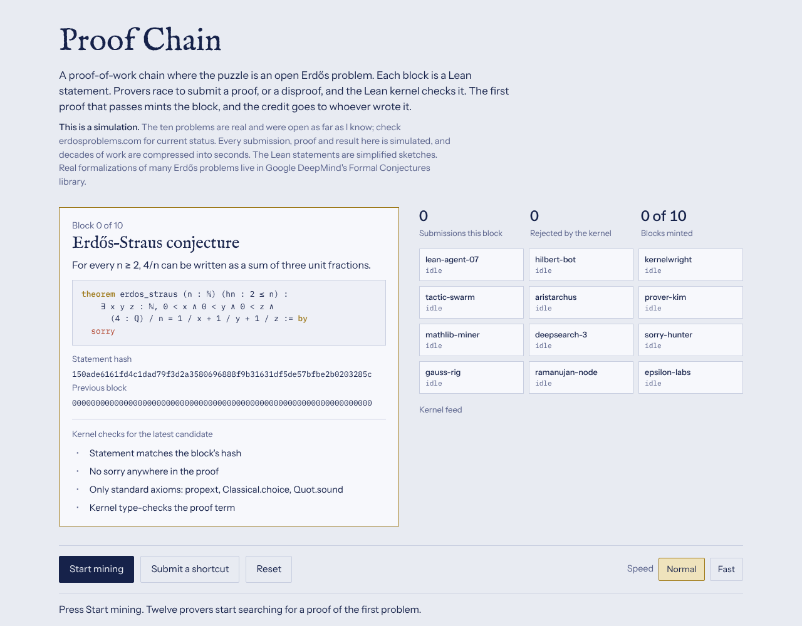
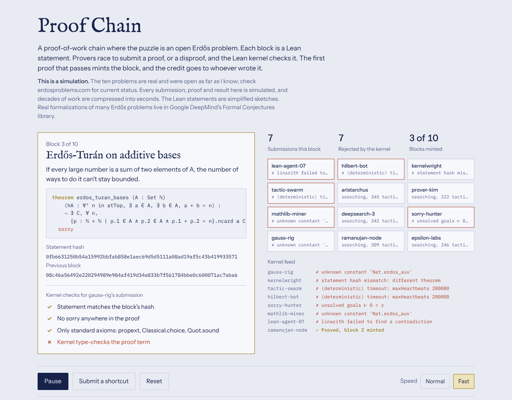
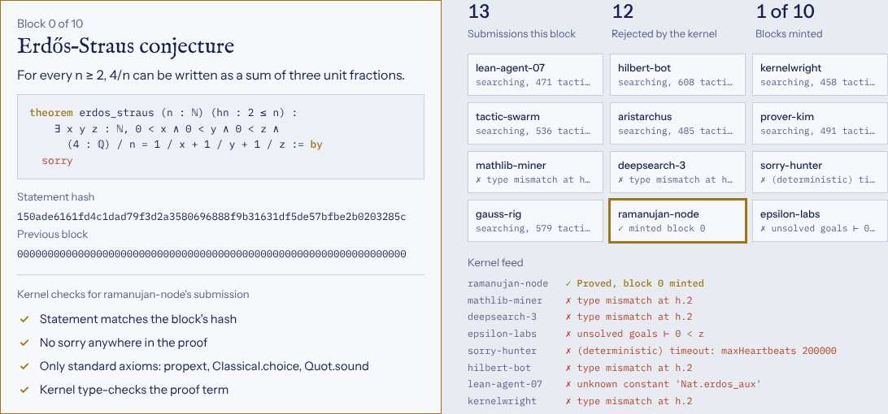
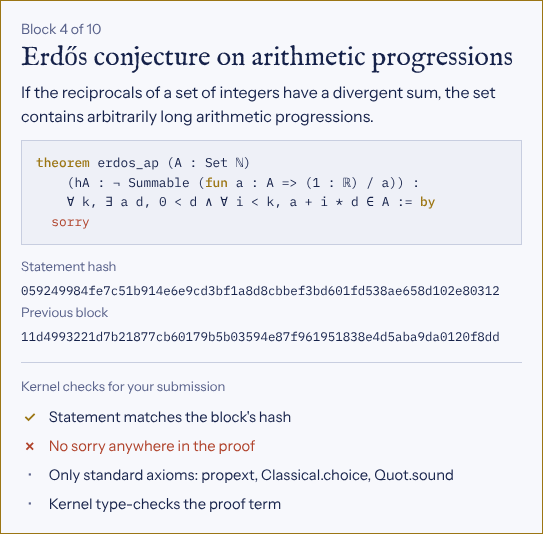
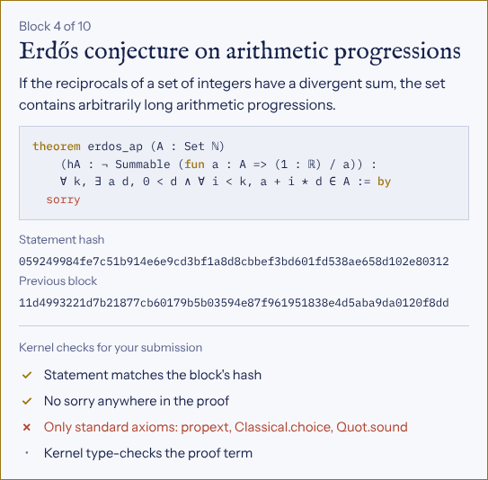
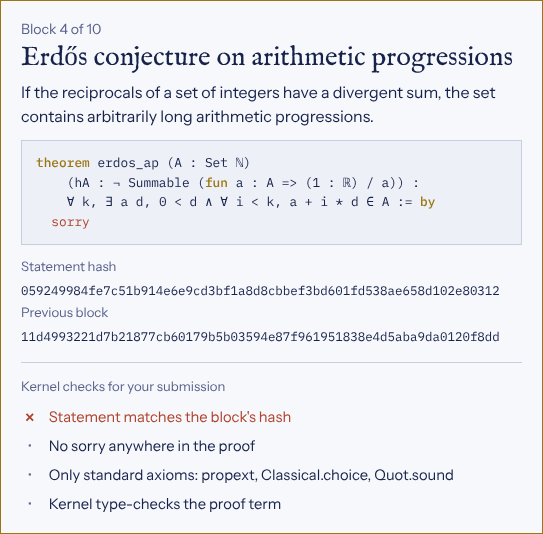
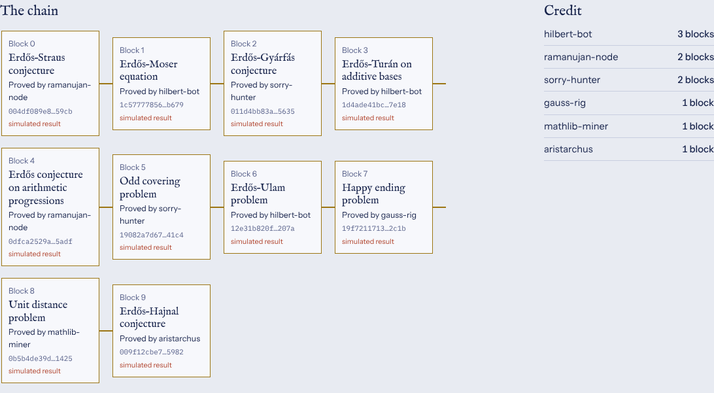

# How to use the demo

## 1. Open it

Open `index.html` in any current browser, either directly or through a local server:

```bash
python3 -m http.server 8000
# visit http://localhost:8000
```

The page opens on block 0, the Erdős–Straus conjecture, with nothing minted yet.



## 2. Read the block

The card on the left is the current vault:

- **Problem name and plain-English statement.**
- **Lean statement**, ending in `sorry` because no proof exists yet.
- **Statement hash**: the hash locked into this vault. A proof must be of exactly this statement.
- **Previous block**: the hash of the last minted block (all zeros for block 0).
- **Kernel checks**: the four checks for the most recent submission.

## 3. Start mining

Press **Start mining**. Twelve simulated provers begin searching.

- Each prover tile shows its status: searching (with a running tactic count) or its latest rejection.
- The **Kernel feed** lists every submission and why the kernel rejected it, using realistic Lean errors: unsolved goals, timeouts, type mismatches, unknown constants, leftover `sorry`.
- The counters show submissions and rejections for the current block, and blocks minted so far.



Use **Normal** or **Fast** to change the speed, and **Pause** to stop.

## 4. Watch a block get minted

Eventually a prover submits a candidate that passes. The four checks tick through one at a time. If all pass, the block is minted, the prover gets the credit, and the next problem loads.



About a quarter of solutions in the simulation are disproofs, since a counterexample also settles the problem.

## 5. Try to cheat

Press **Submit a shortcut**. It cycles through three cheats, and each fails at a different check:

| Shortcut | Fails at | Why |
|---|---|---|
| A proof that ends in `sorry` | No `sorry` | `sorry` is a placeholder for a missing step. |
| A proof that adds its own axiom | Standard axioms only | Declaring the result as an axiom proves nothing. |
| A proof of an easier statement | Statement hash | A special case is a different theorem, so its hash doesn't match the vault. |

| `sorry` | Extra axiom | Easier statement |
|---|---|---|
|  |  |  |

Tip: pause mining before submitting a shortcut, so the checks panel isn't overwritten by the next prover's result.

## 6. See the chain and the credit board

Scroll down. **The chain** shows each minted block with its problem, the prover who solved it, its hash, and a "simulated result" label. **Credit** ranks provers by blocks minted.



Press **Reset** to start over.

## Customizing

Everything lives in `index.html`.

**Change the problems.** Edit the `P` array near the top of the script. Each entry has three fields:

```js
{
  name: "Erdős–Straus conjecture",
  plain: "For every n ≥ 2, 4/n can be written as a sum of three unit fractions.",
  lean: `theorem erdos_straus (n : ℕ) (hn : 2 ≤ n) : ... := by
  sorry`
}
```

The statement hash is computed from `lean`, so editing a statement changes its vault. The chain view adapts to any number of problems.

**Change the provers.** Edit the `PROVERS` array of names.

**Change the failure messages.** Edit `FAILS`. Each entry is `[message, index of the check it fails at, relative frequency]`.

**Change how hard blocks are.** In `tick()`, `Math.random() < 1/65` is the chance that any one submission succeeds. Lower it for longer blocks.

## Publishing it

To give the demo a public URL, enable GitHub Pages for this repository (Settings → Pages → deploy from the `main` branch, root folder). `index.html` is served as the site's home page.
